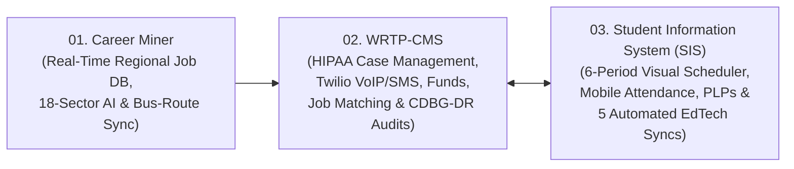
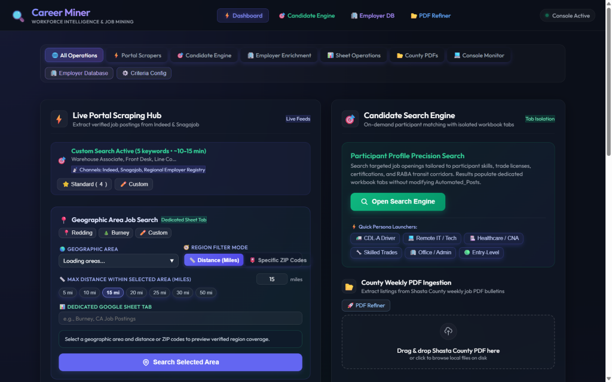
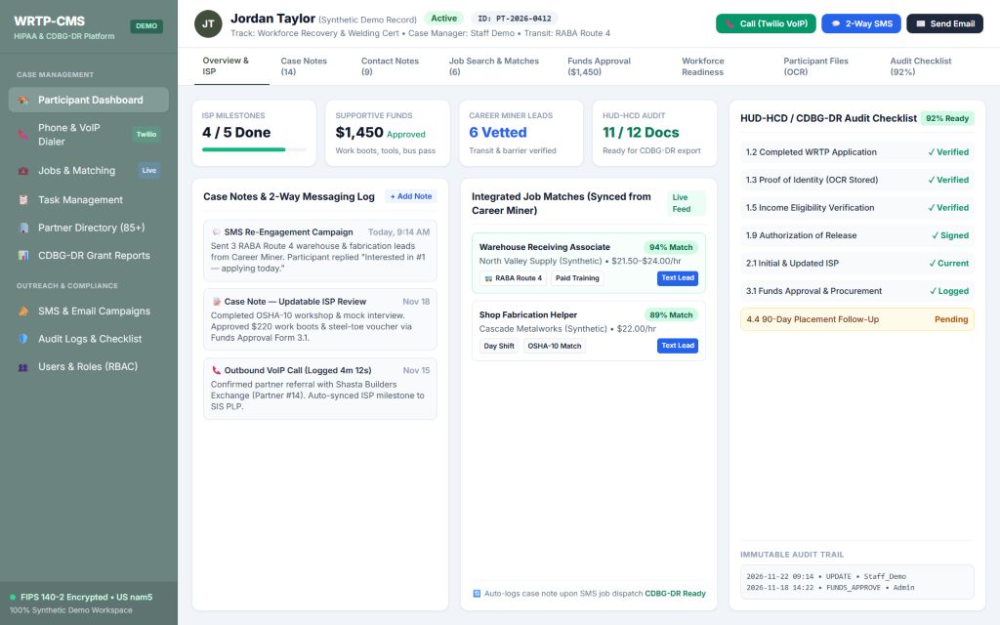
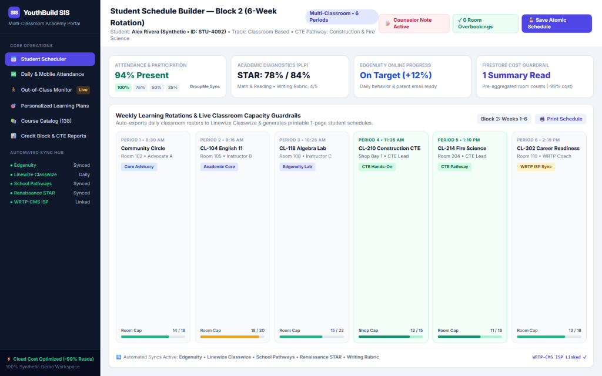

# Brian Cummings — Applied AI, Customer Success & Operations Systems Portfolio

**Location:** Redding, CA (Remote Ready) | **Email:** [briancummings111@gmail.com](mailto:briancummings111@gmail.com) | **LinkedIn:** [linkedin.com/in/briancummings111](https://linkedin.com/in/briancummings111)

[**[ 🌐 View Live Visual Portfolio Page ]**](https://briancummings111-6479.github.io/applied-ai-operations-portfolio/) &nbsp;&nbsp;&nbsp; [**[ 📺 90-Second Video Walkthrough Guide ]**](./assets/MEDIA_CAPTURE_GUIDE.md)

> 🔒 **Portfolio & Confidentiality Notice:** This repository contains plain-English case studies, system architecture diagrams, and sanitized demonstration logic. To maintain strict compliance with California grant reporting standards and HIPAA privacy rules, all production source code, credentials, and participant records are housed in private environments. Live screen-share walkthroughs are available upon request.

---

## Why I Build

When a team is bogged down in repetitive spreadsheet work or confusing setup steps, both staff and clients stall out. I have spent 15+ years running e-commerce and 3PL warehouse operations (cutting client onboarding work by 50% and converting 35%+ of qualified leads), 6 years directing adult training (300+ instructional videos, raising course completion by 25%), and 20 years owning a clinical rehabilitation practice. Because I have worked on the operations floor myself, I build practical AI and database tools that staff actually use.

**How These Systems Evolved:** Each of the three applications below was built initially to solve one urgent operational bottleneck. Because frontline teams adopted them immediately, both the Case Management Software (**WRTP-CMS**) and the **Student Information System (SIS)** expanded from lean point solutions into robust, full-scale production platforms.

---

## At-a-Glance Impact Table (For 6-Second Recruiter Scans)

| Production Software | Initial Problem Solved | How It Expanded & Works (Plain English) | Measurable Operational Result |
| :--- | :--- | :--- | :--- |
| **[01. Career Miner](./case-studies/01-ai-job-discovery-pipeline.md)** *Real-Time Regional Job Database & AI Enrichment System* | Created to automate collection of active job listings for entry-level grant participants (previously 8+ hrs/week of manual board hunting). | Multi-board scraper & Flask console (Python, Playwright/Scrapling, Gemini API, RABA GTFS bus transit) maintaining a nearly real-time active job database for entry-level cohorts plus isolated personalized searches for skilled seekers—scalable to regional workforce agencies. | **80%–90% reduction in manual search labor; nearly real-time regional job database synced directly to WRTP-CMS.** |
| **[02. WRTP-CMS](./case-studies/02-hipaa-case-management-system.md)** *HIPAA & HUD-HCD Compliant Case Management Software* | Created to replace paper folders and manual Google Drive/Docs record-keeping with secure, HUD-HCD grant-compliant case noting. | Expanded into a full HIPAA/PII-secure Firebase platform (React, TypeScript, Twilio Voice & SMS): Case & Contact Notes, in-app VoIP phone, 2-way SMS/Email engagement & re-engagement campaigns, integrated Job Search & Matching, Kiosk Intake + OCR, updatable ISPs, Funds Approvals, Workforce Readiness, Audit Checklists, CDBG-DR reporting, tasks, and an 85+ Partner Directory. | **Massive increase in team capacity & staff hours reclaimed across daily casework, outreach, and CDBG-DR grant audits (35+ active partners).** |
| **[03. Student Information System (SIS)](./case-studies/03-student-information-system.md)** *Multi-Classroom Academy Scheduling, Attendance & EdTech Hub* | Created when the school expanded from a single-room all-day classroom to a new multi-classroom site with 6 daily periods. | Expanded into a school-wide React + Firebase SIS: 6-Week Visual Student Scheduler & 138-course catalog with room capacity guardrails, Desktop & Mobile Attendance + Out-of-Class Monitor + GroupMe alerts, Personalized Learning Plans (PLPs), and 5 automated EdTech syncs (Edgenuity, Linewize Classwize, School Pathways, Renaissance STAR, Writing Rubric) + WRTP-CMS ISP sync. | **Smooth multi-classroom scaling with 0 room overbooks; Cloud Functions refactor cut Firestore read costs by 99%+ (from $50–$100/day to pennies).** |

---

## How the Three Production Systems Connect

Rather than building isolated scripts, I wired all three production systems into one connected operational pipeline:

---

## Live Visual Previews (100% Synthetic Demo Data)

Every screenshot below displays 100% synthetic demonstration records with zero real participant, employer, or student PII.

### 1. Career Miner — Real-Time Regional Job Database & AI Enrichment Console

*Caption: Career Miner's live Flask console combining multi-portal scraping (Indeed, Snagajob, regional employer registries), geographic ZIP/mile scoping, county weekly PDF ingestion, and isolated personalized search launchers for both entry-level and skilled candidates.*

### 2. WRTP-CMS — HIPAA & HUD-HCD Compliant Case Management Software

*Caption: Unified HIPAA & PII-secure participant workspace integrating Case & Contact Notes, Twilio VoIP/2-Way SMS/Email outreach, updatable ISPs, Funds Approvals, live Career Miner job matches, 85+ Partner Directory, and a 24-point HUD-HCD / CDBG-DR Audit Checklist.*

### 3. Student Information System (SIS) — Multi-Classroom 6-Period Scheduler & Sync Hub

*Caption: Multi-classroom, 6-period visual student schedule builder featuring real-time room capacity guardrails, Counselor Notes, granular attendance/GroupMe sync, automated integrations across 5 EdTech platforms, and a 1-read Firestore summary cost guardrail.*

---

## Executive Case Studies (3-Minute Reads)

Each case study covers the origin bottleneck, plain-English solution, security/cost guardrails, and operational result:

1. **[Case Study 01: Career Miner — Real-Time Regional Job Database & AI Enrichment System](./case-studies/01-ai-job-discovery-pipeline.md)**
   *How a collector built for entry-level grant participants evolved into a scalable regional job database and personalized search console—cutting manual job-board labor by 80%–90%.*
2. **[Case Study 02: WRTP-CMS — HIPAA & HUD-HCD Compliant Case Management Software](./case-studies/02-hipaa-case-management-system.md)**
   *How replacing paper folders and Google Drive docs with secure HUD-HCD case noting expanded into an all-in-one CMS with VoIP, SMS campaigns, funds approvals, job matching, and CDBG-DR reporting.*
3. **[Case Study 03: Student Information System (SIS) — Multi-Classroom Scheduling, Attendance & EdTech Hub](./case-studies/03-student-information-system.md)**
   *How an urgent shift from a 1-room classroom to a 6-period multi-classroom site drove a full custom SIS with 5 automated EdTech integrations and a 99%+ cloud database cost reduction.*

---

## Sanitized Demonstration Logic (4 Reference Files for Technical Reviewers)

- **[`sanitized-demos/gemini_job_matcher_demo.py`](./sanitized-demos/gemini_job_matcher_demo.py)** — *(Career Miner)* Plain-English commented Python script showing strict Pydantic JSON schema enforcement with the Gemini API (`gemini-3.8-flash`).
- **[`sanitized-demos/synthetic_job_matches.json`](./sanitized-demos/synthetic_job_matches.json)** — *(Career Miner)* 100% synthetic JSON output illustrating scored candidate matches, extracted wage floors, bus-route checks, and barrier flags.
- **[`sanitized-demos/hipaa_sync_schema_demo.ts`](./sanitized-demos/hipaa_sync_schema_demo.ts)** — *(WRTP-CMS)* TypeScript schema and validation demo showing deterministic field mapping and PII separation for HUD-HCD grant reporting.
- **[`sanitized-demos/sis_cost_aggregation_demo.ts`](./sanitized-demos/sis_cost_aggregation_demo.ts)** — *(Student Information System)* TypeScript Cloud Function pre-aggregation pattern that cut Firestore read operations by **99%+** while preventing classroom overbooking.

---

## Operational Leadership Track Record

| Domain | Experience | Core Operational Achievement |
| :--- | :--- | :--- |
| **E-Commerce & 3PL Operations** | 15+ Years (*Prep It Pack It Ship It*, Amazon Seller Central) | Cut client onboarding workload by **50%** via structured SOPs and support workflows; converted **35%+** of prospective leads into long-term clients. |
| **User Enablement & Adult Training** | 6 Years (*E-Commerce Business School* & Regional Workshops) | Built a student milestone system lifting course completion by **25%**, backed by **300+ training videos**, **150+ podcast episodes**, and **80+ live career workshops**. |
| **Clinical Practice & Regional Partnerships** | 20 Years (Clinical Rehabilitation Practice Owner & Partner Ops) | Owned and operated a clinical practice; built compliant operational systems connecting **85+ regional partner organizations** (35+ active). |

---

## Let's Connect

If your team needs an operations or customer success leader who doesn't just write tickets about workflow bottlenecks—but builds the SOPs, AI automations, and adoption systems that fix them—let's talk.

- **Email:** [briancummings111@gmail.com](mailto:briancummings111@gmail.com)
- **LinkedIn:** [linkedin.com/in/briancummings111](https://linkedin.com/in/briancummings111)
- **Live Visual Portfolio:** [https://briancummings111-6479.github.io/applied-ai-operations-portfolio/](https://briancummings111-6479.github.io/applied-ai-operations-portfolio/)
