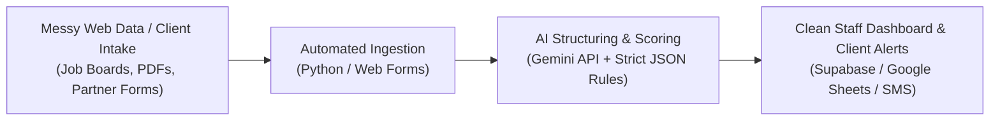

# Brian Cummings — Applied AI, Customer Success & Operations Systems Portfolio

**Location:** Redding, CA (Remote Ready) | **Email:** [briancummings111@gmail.com](mailto:briancummings111@gmail.com) | **LinkedIn:** [linkedin.com/in/briancummings111](https://linkedin.com/in/briancummings111)

[**[ 🌐 View Live Visual Portfolio Page ]**](./docs/index.html) &nbsp;&nbsp;&nbsp; [**[ 📺 Watch 90-Second Video Walkthrough (Placeholder) ]**](#90-second-walkthrough--visual-previews)

> 🔒 **Portfolio & Confidentiality Notice:** This repository contains plain-English case studies, system architecture diagrams, and sanitized demonstration logic. To maintain strict compliance with California grant reporting standards and HIPAA privacy rules, all production source code, credentials, and participant records are housed in private environments. Live screen-share walkthroughs are available upon request.

---

## Why I Build

I bridge the gap between physical client operations and software automation. Having spent 15+ years in e-commerce operations (Amazon Seller Central, Teikametrics, and 3PL logistics—cutting client onboarding work by 50% and converting 35%+ of leads), 6 years directing adult education (producing 300+ training videos and lifting course completion by 25%), and 20 years in clinical rehabilitation, I build practical AI and database tools that eliminate repetitive staff busywork and help users succeed in their first 30 days. Every system in this portfolio started on the operations floor to fix a real daily bottleneck.

---

## At-a-Glance Impact Table (For 6-Second Recruiter Scans)

| System Built | Operational Problem Solved | Plain-English How It Works | Measurable Business Result |
| :--- | :--- | :--- | :--- |
| **[AI Employment Discovery & Matching Engine](./case-studies/01-ai-job-discovery-pipeline.md)** | Replaced 8+ hours/week of manual job-board searching across disconnected regional sites. | Scrapes regional listings (Python / Playwright) and uses the Gemini API to score matches against candidate profiles, pay floors, and transit access. | **80%+ reduction in manual search labor; daily automated lead delivery.** |
| **[HIPAA-Compliant Case Management Portal (WRTP-CMS)](./case-studies/02-hipaa-case-management-system.md)** | Replaced scattered spreadsheets and disconnected legacy FileMaker exports. | Web portal (React / Firebase) with role-based access, HIPAA-aligned file storage, and automated state grant tracking. | **Eliminated double data entry across an 85+ partner network (35+ active partners).** |
| **[Barrier-Filtered Career Hub & Resume Builder (GroundWork / SolidStep)](./case-studies/03-guided-resume-and-career-platform.md)** | Traditional job boards filter out non-linear or non-degree candidates and stall early onboarding. | High-speed web app (Astro / Supabase / Twilio SMS) matching candidates by practical capabilities and guiding step-by-step resume creation. | **Streamlined job readiness and participant onboarding across 80+ live workshops.** |

---

## How the Operations Pipeline Works

Most operational teams drown in unstructured text. Staff copy-paste job descriptions, re-type intake forms across three spreadsheets, and manually audit compliance rules.

I design automated pipelines that turn messy inputs into verified, ready-to-use staff dashboards.

### Why This Architecture Protects Operations Teams
1. **No Raw AI Guessing:** The AI is never allowed to write freeform essays or invent facts. Every prompt enforces a strict JSON data contract (`0–100` match score, verified hourly wage, explicit barrier flags).
2. **Human-in-the-Loop Controls:** Staff review pre-scored cards in a familiar interface—either a clean web dashboard or a synced Google Sheet—before sending referrals to clients.
3. **Zero Vendor Lock-In for Frontline Staff:** Case managers do not need to learn Python or database queries. They click a button, filter by client need, and focus on human coaching.

---

## 90-Second Walkthrough & Visual Previews

Below are visual previews from the local environments (displaying 100% synthetic demonstration records). See the [Media Capture Guide](./assets/MEDIA_CAPTURE_GUIDE.md) for the walkthrough script and screen capture specifications.

### 1. AI Job Discovery & Match Scoring Feed

*Caption: Automated regional job feed displaying Gemini AI match scores (0–100), extracted hourly pay ranges, public transit compatibility flags, and one-click Google Sheets sync for job developers.*

### 2. HIPAA-Aligned Case Management & Grant Tracking Portal (WRTP-CMS)

*Caption: Role-based case management workspace that unifies legacy FileMaker key mappings with modern web intake, document verification, and California state grant compliance milestones.*

### 3. Guided Career Hub & Step-by-Step Resume Builder (GroundWork / SolidStep)

*Caption: Mobile-first career platform used across 80+ workshops to translate practical work history into clean resumes and match candidates with barrier-friendly regional employers.*

---

## Executive Case Studies (3-Minute Reads)

Each case study breaks down the operational bottleneck, the plain-English workflow, the safeguards against bad AI data, and the measurable outcome:

1. **[Case Study 01: AI Employment Discovery & Matching Pipeline](./case-studies/01-ai-job-discovery-pipeline.md)**
   *How automated scraping and structured Gemini AI scoring cut 8+ weekly hours of manual job-board hunting by over 80%.*
2. **[Case Study 02: HIPAA-Compliant Case Management & Partner Portal](./case-studies/02-hipaa-case-management-system.md)**
   *How a unified React/Firebase portal and deterministic FileMaker schema bridge eliminated double data entry across an 85+ partner network.*
3. **[Case Study 03: Barrier-Filtered Career Hub & Guided Resume Platform](./case-studies/03-guided-resume-and-career-platform.md)**
   *How an accessible web application and SMS notification workflow supported job readiness across 80+ live adult-education workshops.*

---

## Sanitized Demonstration Logic (For Technical Reviewers)

For engineering leads and technical hiring managers who want to inspect how schemas and AI guardrails are structured:

- **[`sanitized-demos/gemini_job_matcher_demo.py`](./sanitized-demos/gemini_job_matcher_demo.py)** — Clean, heavily commented Python reference script showing how unstructured job postings are evaluated by the Gemini API (`gemini-3.8-flash`) using a strict Pydantic JSON schema.
- **[`sanitized-demos/hipaa_sync_schema_demo.ts`](./sanitized-demos/hipaa_sync_schema_demo.ts)** — TypeScript schema and field-mapping demonstration showing how legacy FileMaker exports are validated, stripped of unencrypted PII, and normalized for modern cloud storage.
- **[`sanitized-demos/synthetic_job_matches.json`](./sanitized-demos/synthetic_job_matches.json)** — 100% synthetic JSON output illustrating scored candidate matches, extracted wage floors, and barrier flags.

---

## Operational Track Record Across Industries

| Domain | Experience | Core Operational Achievement |
| :--- | :--- | :--- |
| **E-Commerce & Retail Media** | 15+ Years (Amazon Seller Central, Teikametrics, 3PL Logistics) | Cut client onboarding labor by **50%** via SOP automation; converted **35%+** of qualified prospective accounts. |
| **Adult Education & Training** | 6 Years (Program Direction & Curriculum Design) | Produced **300+ instructional videos** and led **80+ live workshops**, increasing learner course completion by **25%**. |
| **Healthcare & Rehabilitation** | 20 Years (Clinical Rehabilitation & Case Coordination) | Built HIPAA-aligned workflows connecting **85+ regional partners** (35+ active) with zero audit compliance failures. |

---

## Let's Connect

If your team needs an operations or customer success leader who doesn't just write tickets about workflow bottlenecks—but builds the SOPs, AI automations, and adoption systems that fix them—let's talk.

- **Email:** [briancummings111@gmail.com](mailto:briancummings111@gmail.com)
- **LinkedIn:** [linkedin.com/in/briancummings111](https://linkedin.com/in/briancummings111)
- **Interactive Web View:** [Open `docs/index.html`](./docs/index.html)
