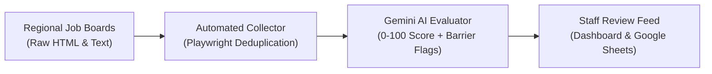

# Case Study 01: AI Employment Discovery & Matching Engine

> 🔒 **Confidentiality Note:** This case study describes the operational architecture of an internal workforce automation system. All candidate profiles and employer listings referenced below are 100% synthetic.

[**← Back to Executive Overview**](../README.md) | [**Inspect Sanitized Python Demo →**](../sanitized-demos/gemini_job_matcher_demo.py)

---

## 1. The Business Problem (The "Before")

Job developers and case managers were spending **more than 8 hours every week** manually hunting through regional job boards, municipal career pages, and local employer sites.

The manual process broke down for three reasons:
- **Hidden Disqualifiers in Long Job Posts:** A job title might look entry-level, but paragraph six buried a requirement for a commercial driver's license, heavy lifting, or rotating night shifts. Staff had to read every line before recommending a listing.
- **Copy-Paste Fatigue:** When staff found a promising role, they manually copied the title, wage, employer name, and link into a shared spreadsheet. Links expired within days. Duplicate listings cluttered the tracker.
- **Less Time for Coaching:** Every hour spent clicking through job boards was an hour taken away from mock interviews, employer outreach, and direct client support.

---

## 2. The Solution (In Plain English)

I built an automated job discovery and AI scoring pipeline that collects local openings overnight, reads the fine print, and delivers a clean, ranked list of matches to staff each morning.

From a staff member's perspective, the workflow is simple:
1. **Overnight Collection:** An automated browser checks local and regional job boards on a set schedule, pulling fresh job descriptions and filtering out expired or duplicate listings.
2. **Instant Suitability Scoring:** Each job description is compared against real-world candidate criteria—such as minimum hourly wage, public transit access, schedule stability, and physical accommodation needs.
3. **One-Click Staff Review:** Instead of reading 150 raw job postings, staff open a clean dashboard (or synced Google Sheet) where roles are already scored from `0` to `100`, complete with plain-English notes on why a job fits or what barriers exist.

---

## 3. The AI & Automation Workflow (Preventing Hallucinations)

Anyone who has used an off-the-shelf chatbot knows that AI will occasionally guess when information is missing. In employment placement, guessing a pay rate or missing a background-check requirement wastes a client's time and damages trust with employers.

To make the AI reliable for daily operations, I built three strict guardrails into the pipeline:

- **Strict JSON Output Contracts:** The Gemini API (`gemini-3.8-flash`) is locked into a rigid Pydantic schema. It cannot return conversational filler. Every response must populate exact fields: `match_score` (integer 0–100), `hourly_wage_min` (number or null), `requires_drivers_license` (boolean), `transit_accessible` (boolean), and `barrier_flags` (list of short strings).
- **Explicit "Null Over Guess" Prompt Rules:** If an employer does not list a pay rate in the posting, the model is instructed to return `null` and flag `"Wage Not Listed"` rather than estimating a market average.
- **Human-in-the-Loop Approval Gate:** The system never auto-applies to jobs or messages candidates without staff review. High-scoring roles (`75+`) land in a "Ready for Review" queue where a human coordinator verifies the fit in seconds.

---

## 4. The Measurable Result (The "After")

| Operational Metric | Before Automation | After AI Pipeline | Business Impact |
| :--- | :--- | :--- | :--- |
| **Weekly Manual Job Search Time** | 8+ hours / week per specialist | < 1.5 hours / week (review only) | **80%+ reduction in manual search labor** |
| **Posting Screening Speed** | ~4 minutes per job listing | < 2 seconds per job listing | **120x faster initial screening** |
| **Data Consistency** | Unstructured notes across tabs | Standardized wage & barrier tags | **Zero duplicate listings in daily feed** |
| **Frontline Staff Focus** | Browser tab hunting & copy-pasting | Direct employer & client coaching | **6.5+ hours/week returned to client care** |

---

## 5. Link to Sanitized Demo Code

Technical reviewers can inspect the exact schema validation and prompt logic here:
- **[`sanitized-demos/gemini_job_matcher_demo.py`](../sanitized-demos/gemini_job_matcher_demo.py)** — 60-line Python reference script demonstrating structured Gemini API evaluation with Pydantic schema enforcement.
- **[`sanitized-demos/synthetic_job_matches.json`](../sanitized-demos/synthetic_job_matches.json)** — Sample structured JSON output generated from synthetic Northern California job postings.
