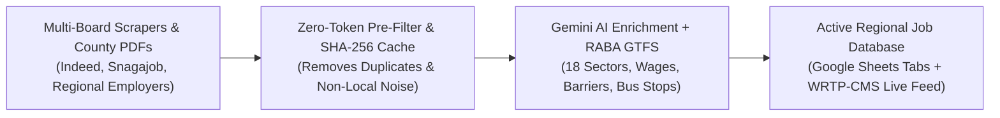

# Case Study 01: Career Miner — Real-Time Regional Job Database & AI Enrichment System

> 🔒 **Confidentiality Note:** This case study describes the operational architecture of a workforce intelligence system built for regional job placement. All candidate profiles and employer listings shown in this repository are 100% synthetic.

[**← Back to Executive Overview**](../README.md) | [**Inspect Sanitized Python Demo →**](../sanitized-demos/gemini_job_matcher_demo.py)

---

## 1. Origin & The Business Problem (The "Before")

**Career Miner** started with one clear goal: automate the collection of active local job listings for entry-level grant participants.

Before this system existed, job developers spent **more than 8 hours every week** clicking through Indeed, Snagajob, Glassdoor, and weekly county PDF job bulletins. That manual workflow broke down fast:
- **Hidden Disqualifiers in Long Posts:** A listing might look entry-level at the top, yet paragraph six required a Class B commercial license, heavy lifting over 60 lbs, or a 4:30 AM shift before city buses run.
- **No Shared Active Database:** Staff copied promising leads into disconnected spreadsheets. Postings expired within days, duplicates piled up, and no one had a clean registry of regional employers who regularly hire entry-level or youth workers.
- **Zero Scalability for Skilled Seekers:** Entry-level cohorts needed barrier-checked roles on public transit, while skilled trades or healthcare candidates needed personalized searches without polluting the shared entry-level job sheet.

---

## 2. The Solution (In Plain English)

Career Miner evolved from a simple collector into a **nearly real-time active job listing database and AI enrichment console**—designed to scale across regional workforce agencies for both entry-level cohorts and skilled job seekers.

Here is how operations staff use the Flask web console daily:
1. **Multi-Channel Regional Harvesting:** Pulls active listings from Indeed, Snagajob, regional employer registries, and drag-and-drop county weekly PDF bulletins, filtered by exact geographic corridors and ZIP codes.
2. **Real-Time AI Enrichment & 18-Sector Taxonomy:** Passes every raw job posting through a local zero-token pre-filter (blocking remote scams, survey panels, or executive roles) and a structured Gemini AI parser that classifies roles across **18 workforce sectors** and extracts exact pay rates, age rules, license requirements, drug/background checks, and physical demands.
3. **Municipal Bus-Route Verification (RABA GTFS):** Cross-references every worksite street address against live municipal GTFS bus stop coordinates so transit-dependent job seekers only receive jobs they can physically reach.
4. **Personalized Search for Skilled Seekers (Tab Isolation):** Job developers launch one-click targeted searches for specific candidate personas (`CDL-A Driver`, `Remote IT / Tech`, `Healthcare / CNA`, `Skilled Trades`, `Office / Admin`, `Entry-Level`) into isolated Google Sheet tabs—without overwriting the master entry-level feed.
5. **Automated Expiry Auditor & Direct CMS Sync:** Checks active listings for expired links, removes dead postings with one-click undo protection, enriches an internal SQLite **Employer Registry**, and syncs verified leads directly into **WRTP-CMS**.

---

## 3. AI Guardrails & Cost Control

Uncontrolled AI scraping burns API budgets and produces sloppy guesses. Career Miner prevents both with three engineering controls:

- **Persistent SHA-256 Deduplication Cache:** Before calling the Gemini API, the pipeline hashes the job title, company, location, pay, and description. Repeat listings cost zero API tokens.
- **Strict Pydantic JSON Schema ("Unstated Over Guess"):** The model must populate structured fields (`is_entry_level`, `sector`, `pay_rate`, `min_age`, `is_teen_friendly`, `driver_license_type`, `requires_drug_test`, `requires_background_check`). If wages are missing, the parser returns `"Unstated"` instead of fabricating a market average.
- **Human-in-the-Loop Triage:** Unregistered regional employers land in a triage queue where staff approve or enrich company profiles with one click before listings publish to participant feeds.

---

## 4. The Measurable Result (The "After")

| Operational Metric | Before Career Miner | After Career Miner | Business Impact |
| :--- | :--- | :--- | :--- |
| **Weekly Manual Job Search Time** | 8+ hours / week per specialist | < 1.5 hours / week (review only) | **80%–90% reduction in manual search labor** |
| **Listing Enrichment Speed** | ~4 minutes manual reading per post | < 2 seconds automated enrichment | **Nearly real-time active job database** |
| **Transit & Barrier Accuracy** | Manual Google Maps tab-switching | Automated RABA GTFS + 18-sector AI tags | **Eliminated dead-end referrals** |
| **Skilled vs. Entry-Level Scope** | One-size-fits-all manual search | Isolated personalized candidate tabs | **Scalable across regional workforce agencies** |

---

## 5. Sanitized Demonstration Logic

Technical reviewers can inspect the structured evaluation logic and sample output here:
- **[`sanitized-demos/gemini_job_matcher_demo.py`](../sanitized-demos/gemini_job_matcher_demo.py)** — Heavily commented Python reference script showing strict Pydantic JSON schema enforcement with the Gemini API.
- **[`sanitized-demos/synthetic_job_matches.json`](../sanitized-demos/synthetic_job_matches.json)** — 100% synthetic JSON output demonstrating scored matches, hourly wage extraction, transit verification, and barrier flags.
