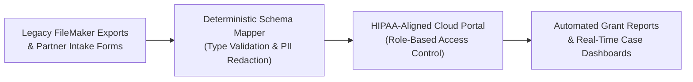

# Case Study 02: HIPAA-Compliant Case Management & Partner Portal (WRTP-CMS)

> 🔒 **Confidentiality Note:** To comply with HIPAA privacy rules and California state grant regulations, all production database credentials and participant records remain in private environments. The schema mappings shown in this repository use 100% synthetic fields.

[**← Back to Executive Overview**](../README.md) | [**Inspect Sanitized TypeScript Schema →**](../sanitized-demos/hipaa_sync_schema_demo.ts)

---

## 1. The Business Problem (The "Before")

Coordinating participant intake, clinical or vocational milestones, and state grant reporting across a network of **85+ regional partner organizations** (with 35+ active partners submitting weekly updates) created a severe administrative bottleneck.

Staff faced three daily friction points:
- **Legacy Database Silos:** Historical records lived inside an aging FileMaker database with inconsistent field names, while frontline staff tracked daily progress in separate spreadsheets and email threads.
- **Double and Triple Data Entry:** Whenever a participant completed a training milestone or updated an intake form, staff had to type the same notes into the local spreadsheet, the legacy database, and the quarterly state grant report.
- **Privacy & Audit Exposure:** Passing spreadsheets back and forth over email made version control nearly impossible and introduced unnecessary privacy risk when handling sensitive participant documents.

---

## 2. The Solution (In Plain English)

I designed and built **WRTP-CMS**, a centralized web portal (React and Firebase) that gives case managers and partner organizations a single, secure place to manage participant progress from day one.

Here is how the portal works for non-technical users:
1. **Role-Based Workspaces:** When a partner or case manager logs in, they only see the specific participants and forms assigned to their role. No clutter, and no accidental exposure of unauthorized records.
2. **Guided Milestone Checklists:** Instead of guessing which documents are missing for state grant compliance, staff see a visual progress bar for every participant—covering intake verification, barrier assessments, training hours, and placement outcomes.
3. **Legacy FileMaker Bridge:** Behind the scenes, an automated schema mapper translates messy legacy FileMaker export keys into clean, standardized web records so historical data isn't lost during transition.

---

## 3. The AI & Automation Workflow (Data Integrity & Privacy Safeguards)

When handling health-adjacent case files and state-funded grant metrics, accuracy and privacy come first. You cannot let an unverified script or an AI prompt alter a participant's compliance status.

I implemented strict deterministic and human-verified rules across the system:
- **Deterministic Key Mapping:** Legacy FileMaker fields (such as `Pt_Intake_Dt_v2` or `Bar_Code_04`) pass through a strict TypeScript validation layer before touching the cloud database. Invalid dates or malformed IDs are quarantined for human review rather than silently corrupting the record.
- **Automated PII Separation:** Identifiable client contact details are separated from aggregate grant-reporting metrics. Administrators can generate state compliance summaries in seconds without exposing private case notes.
- **Audit Trails on Every Edit:** Every status change records a timestamp and staff user ID, turning end-of-quarter grant audits from a two-week fire drill into a routine export.

---

## 4. The Measurable Result (The "After")

| Operational Metric | Before Portal (Spreadsheets + FileMaker) | After WRTP-CMS Portal | Business Impact |
| :--- | :--- | :--- | :--- |
| **Partner Network Coordination** | Manual email chains across 85+ partners | Unified portal for 85+ partners (35+ active) | **Single source of truth across region** |
| **Data Entry Workflow** | 3x manual entry per milestone | Enter once; auto-syncs to grant reports | **Eliminated double data entry** |
| **Grant Audit Preparation** | Days of manual spreadsheet reconciliation | Instant filtered compliance views | **Zero missed reporting deadlines** |
| **New Staff Onboarding** | Weeks learning quirky spreadsheet tabs | Guided visual forms with built-in checks | **Faster staff ramp-up & fewer typos** |

---

## 5. Link to Sanitized Demo Code

Technical reviewers can inspect how legacy FileMaker exports are validated and sanitized in TypeScript:
- **[`sanitized-demos/hipaa_sync_schema_demo.ts`](../sanitized-demos/hipaa_sync_schema_demo.ts)** — Sanitized TypeScript schema, legacy key-mapping dictionary, and HIPAA audit-log transformation demo.
