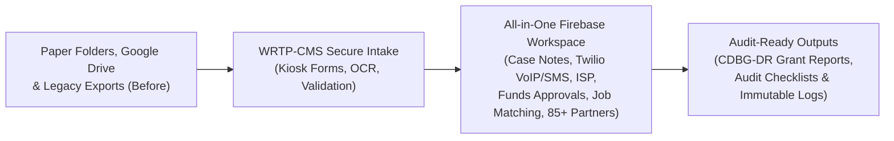

# Case Study 02: WRTP-CMS — HIPAA & HUD-HCD Compliant Case Management Software

> 🔒 **Confidentiality Note:** To comply with HIPAA privacy rules, PII protection standards, and California HUD-HCD / CDBG-DR grant regulations, all production source code, credentials, and real participant records remain in private environments. All UI previews and schema demos in this repository use 100% synthetic data.

[**← Back to Executive Overview**](../README.md) | [**Inspect Sanitized TypeScript Schema →**](../sanitized-demos/hipaa_sync_schema_demo.ts)

---

## 1. Origin & The Business Problem (The "Before")

**WRTP-CMS** began with a focused compliance need: give our Workforce Recovery Training Program a secure, **HUD-HCD grant-compliant record-keeping and case-noting system** to replace paper folders and manual tracking across Google Drive and Google Docs.

Before the platform existed, frontline staff were fighting their own filing system every day:
- **Paper Folders & Scattered Google Drive Docs:** Participant intake packets, eligibility proofs, case notes, and service plans lived across physical binders, shared Drive folders, and disconnected spreadsheets. Finding a single missing signature before a grant audit took hours.
- **Disconnected Outreach Channels:** Staff made calls from desk phones, sent texts from separate tools, and emailed reminders from personal inboxes—then had to manually re-type every interaction as a compliance case note later.
- **Double Data Entry Across Grant Reports:** Tracking supportive service spending, workforce readiness milestones, and referrals across **85+ regional partner organizations (35+ active)** required re-entering the same data multiple times for internal tracking and CDBG-DR state grant reports.

---

## 2. How Initial Success Expanded Into a Full-Scale Platform

Once staff saw how quickly secure digital case noting eliminated paper chaos, WRTP-CMS expanded module by module into a comprehensive, all-in-one **HIPAA-compliant and PII-secure Firebase Case Management Software** platform (React, TypeScript, Firebase US multi-region `nam5`, FIPS 140-2 encryption, Twilio Voice & SMS, and Gemini AI):

- **End-to-End Participant Record Management:** Kiosk & Enrollment Intake forms, Document OCR extraction, Updatable Individual Service Plans (ISP), Participant Files & Attachments, Case Notes, Contact Notes, Workforce Readiness tracking, WorkDocs Checklists, and Duplicate Resolution.
- **Built-In Multi-Channel Communications Hub:** Live in-browser **Twilio VoIP Phone & Dialer**, **2-Way SMS** inbox, integrated **Email**, Group Broadcasts, and automated **Email & SMS Engagement and Re-Engagement Campaigns**—automatically logging outreach touchpoints directly to participant records.
- **Integrated Job Search & Matching:** Pulls transit-checked, AI-enriched openings directly from **Career Miner** into each participant's dashboard so case managers can match and text vetted job leads with one click.
- **Financial Controls & Grant Compliance:** Digital **Funds Approvals & Supportive Services spending** tracking (Form 3.1/3.2 workflows), **Audit Logs & per-client Audit Checklists**, **CDBG-DR Grant Reporting**, User Role Management, Task Management, and a full **85+ Partner Directory & Referral Logging** system.
- **Cross-System Education Sync:** Links participant ISPs directly with our Student Information System's Personalized Learning Plans so dual-enrolled youth never fall through the cracks.

---

## 3. Security, Privacy & Data Integrity Architecture

Handling health-adjacent recovery files and federal/state HUD-HCD grant funding leaves zero margin for sloppy data handling:

- **US Data Sovereignty & Encryption:** Hosted on Google Cloud / Firebase North America multi-region (`nam5`) with FIPS 140-2 validated encryption at rest and in transit.
- **Deterministic Schema Validation & PII Separation:** Legacy imports pass through strict TypeScript validators that quarantine malformed records and keep private case notes cleanly separated from aggregate grant-reporting exports.
- **Immutable Audit Trails & Per-Client Checklists:** Every critical record change captures timestamps and user IDs, while built-in 24-point HUD-HCD audit checklists flag missing documents before monitors arrive.

---

## 4. The Measurable Result (The "After")

The massive increase in team capacity and reduction in weekly staff hours across case noting, outreach campaigns, funds approvals, job matching, and audit prep is difficult to capture in a single percentage—it transformed how the entire agency operates:

| Operational Area | Before WRTP-CMS | After WRTP-CMS | Operational Impact |
| :--- | :--- | :--- | :--- |
| **Participant Files & Notes** | Paper folders, Google Drive & Docs | HIPAA & PII-secure Firebase workspace | **Single source of truth for every client** |
| **Client Outreach & Follow-Up** | Separate phone, SMS & email silos | Built-in Twilio VoIP, 2-Way SMS & Campaigns | **Automated re-engagement & touchpoint logs** |
| **Grant & Audit Readiness** | Days of manual folder & sheet checks | Live Audit Checklists & CDBG-DR exports | **Eliminated double data entry across reports** |
| **Regional Partner Network** | Unlogged emails across partners | Central 85+ Partner Directory (35+ active) | **Trackable referrals & supportive spending** |

---

## 5. Sanitized Demonstration Logic

Technical reviewers can inspect how legacy records are normalized, validated, and stripped of unencrypted PII for state compliance reporting:
- **[`sanitized-demos/hipaa_sync_schema_demo.ts`](../sanitized-demos/hipaa_sync_schema_demo.ts)** — Sanitized TypeScript schema, legacy key-mapping logic, and privacy-redacted compliance output demo.
