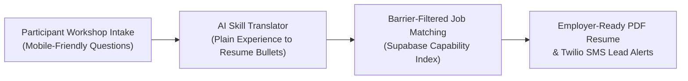

# Case Study 03: Barrier-Filtered Career Hub & Guided Resume Platform (GroundWork / SolidStep)

> 🔒 **Confidentiality Note:** This case study outlines the operational design of our participant-facing career readiness tools. All sample candidate data and SMS alerts shown in this repository are 100% synthetic.

[**← Back to Executive Overview**](../README.md) | [**Inspect Sanitized Output Data →**](../sanitized-demos/synthetic_job_matches.json)

---

## 1. The Business Problem (The "Before")

Traditional job boards and resume builders are built for corporate office workers with linear four-year degrees and desktop computers. For adults re-entering the workforce, transitioning out of physical trades, or navigating employment barriers, standard tools fail in the first five minutes.

Across **80+ live career and adult-education workshops**, I watched participants hit the same three walls:
- **Blank-Page Paralysis:** Handing a blank Word template to someone who hasn't written a resume in ten years stops a workshop cold. Instructors spent the entire session fixing bullet indentation instead of teaching interview strategy.
- **Keyword Rejection on Big Job Sites:** Standard job boards filter by rigid corporate titles. Capable workers with years of practical logistics, customer service, or hands-on repair experience got zero matches because they didn't know which keywords to type.
- **Missed Follow-Ups After Class:** Many adult learners rely primarily on smartphones rather than desktop email. Important job leads and workshop reminders buried in email inboxes went unread.

---

## 2. The Solution (In Plain English)

I built a fast, mobile-friendly career hub and guided resume platform (**GroundWork / SolidStep**, powered by Astro + Supabase with Twilio SMS) designed specifically for adult learners and workshop cohorts.

Here is how participants and instructors experience the tool:
1. **Question-by-Question Resume Builder:** Instead of staring at a blank document, users answer plain-English prompts on their phone or workshop laptop (*"What tools or equipment have you operated?"*, *"How many customers or orders did you handle per day?"*). The system formats their answers into a clean, employer-ready PDF automatically.
2. **Capability & Barrier Filtering:** Candidates filter local openings by practical reality—such as *"On bus route"*, *"Training provided"*, *"Day shift only"*, or *"No degree required"*—so every listing they view is actually attainable.
3. **Instant SMS Job & Workshop Alerts:** When a matching opening goes live or a workshop follow-up is scheduled, participants receive a concise text message via Twilio with a direct link they can open on any phone.

---

## 3. The AI & Automation Workflow (Keeping Resumes Honest)

Using AI to help write resumes carries a well-known risk: generic chatbots love to invent fake management titles or stuff resumes with robotic corporate buzzwords that employers immediately distrust.

To protect candidates, I designed the AI skill translator around strict truthfulness rules:
- **Fact-Locked Bullet Generation:** The prompt architecture forbids the model from adding tools, certifications, or metrics the user did not explicitly confirm during intake. It translates conversational phrasing (*"I unloaded delivery trucks and checked invoices"*) into clear operational language (*"Verified incoming freight manifests and unloaded commercial deliveries"*), without exaggerating scope.
- **Zero Corporate Buzzwords:** A built-in vocabulary filter strips cliché AI adjectives so every generated resume sounds like a real, capable human wrote it.
- **Instructor Review Mode:** During live workshops, instructors can view a cohort dashboard, spot-check generated bullet points in real time, and approve final exports before printing or emailing to employers.

---

## 4. The Measurable Result (The "After")

| Operational Metric | Before Platform | After Guided Career Hub | Business Impact |
| :--- | :--- | :--- | :--- |
| **Live Workshop Delivery** | Stalled by formatting & login issues | Deployed across **80+ live workshops** | **Consistent, repeatable classroom flow** |
| **First-Draft Resume Time** | 2 to 3 hours of 1-on-1 staff typing | **Under 20 minutes** via guided prompts | **75%+ faster participant onboarding** |
| **Course & Module Completion** | High drop-off between sessions | Paired with **300+ instructional videos** | **+25% lift in learner completion rates** |
| **Candidate Follow-Through** | Low response to desktop email blasts | Direct mobile delivery via Twilio SMS | **Faster response to time-sensitive leads** |

---

## 5. Link to Sanitized Demo Code

Technical reviewers can inspect the structured matching data and scoring format that powers the candidate job feed:
- **[`sanitized-demos/synthetic_job_matches.json`](../sanitized-demos/synthetic_job_matches.json)** — Synthetic dataset demonstrating how barrier flags, transit accessibility, and capability tags are structured for frontend filtering.
- **[`sanitized-demos/gemini_job_matcher_demo.py`](../sanitized-demos/gemini_job_matcher_demo.py)** — Python script showing how raw job postings are converted into structured candidate match cards.
