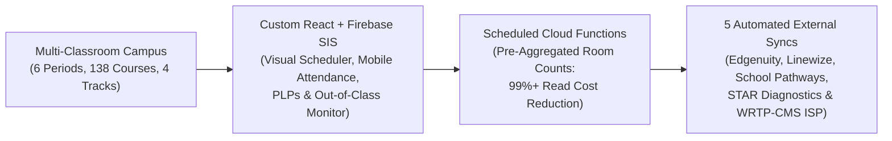

# Case Study 03: Student Information System (SIS) — Multi-Classroom Scheduling, Attendance & EdTech Integration Platform

> 🔒 **Confidentiality Note:** To comply with FERPA student privacy rules, all production source code, credentials, and real student records remain in private environments. All UI previews and code demos in this repository use 100% synthetic data.

[**← Back to Executive Overview**](../README.md) | [**Inspect Sanitized Cloud Cost Demo →**](../sanitized-demos/sis_cost_aggregation_demo.ts)

---

## 1. Origin & The Business Problem (The "Before")

This custom **Student Information System (SIS)** was built for a real operational inflection point at **California Heritage YouthBuild Academy** (serving opportunity youth ages 16–24 across six 6-week academic blocks).

The school was expanding from a **single-room, all-day classroom experience to a new multi-classroom school site with 6 daily periods**. That physical expansion immediately broke manual operations:
- **Spreadsheet Scheduling Collapsed:** Tracking 138 courses across multiple rooms, 6 periods, and four enrollment tracks (Classroom Based, Modified Independent Study, Adult Ed, and Summer School) in Google Sheets led to double-booked rooms, missing schedules, and constant counselor bottlenecks.
- **Fragmented Daily Attendance & Campus Safety:** Teachers needed a fast way to log attendance and participation on desktop or mobile—and staff needed instant visibility into hall passes and students out of class.
- **Five Disconnected EdTech Platforms:** Staff were manually exporting and re-uploading rosters and scores across **Edgenuity**, **Linewize Classwize**, **School Pathways (PLSIS)**, **Renaissance STAR**, and **Google Sheets Writing Rubrics**.

---

## 2. How Initial Success Expanded Into a School-Wide SIS

Once the core multi-classroom scheduler solved the campus expansion crunch, staff adoption drove rapid expansion into a complete, custom-built **React + Firebase Student Information System**:

- **Visual 6-Week Student Scheduler & 138-Course Catalog:** Counselors and students build conflict-free schedules across 6 periods with real-time **Room Capacity Guardrails**, atomic transaction saves, persistent Counselor Scheduling Notes (with visual red alert badges), and one-click printable weekly schedules.
- **Desktop & Mobile Daily Attendance + Out-of-Class Monitor:** Teachers record presence and granular participation (`100%`, `75%`, `50%`, `25%`) from any phone or laptop, while the **Out-of-Class Monitor** and **Attendance Clerk View** track hall passes, tardies, early dismissals, and automated **GroupMe Attendance Alerts**.
- **Personalized Learning Plans (PLP) & Student Portal:** Unifies STAR Math/Reading 4-level rubrics, Writing Diagnostics, credit block tracking, and Edgenuity daily behavior reports (with parent email dispatch) inside a live dashboard accessible to both staff and students.
- **5 Automated EdTech & Compliance Integrations:** Cloud Functions and headless browser automation synchronize daily classroom rosters to **Linewize Classwize**, pull student progress from **Edgenuity**, **Renaissance STAR**, **School Pathways**, and **Writing Rubrics**, and link student career goals directly with **WRTP-CMS Individual Service Plans (ISPs)**.

---

## 3. Cloud Architecture & Cost Engineering (Solving a $50–$100/Day Bottleneck)

Early in the school rollout, real-time Firestore listeners (`onSnapshot`) combined with full-schedule frontend downloads caused cloud database read costs to spike to **$50–$100 per day**.

Instead of accepting high SaaS overhead, I re-engineered the data layer:
- **Scheduled Cloud Function Pre-Aggregation:** A backend Firebase Cloud Function runs every 5 minutes to calculate active enrollment counts per room and period, writing totals into a single tiny summary document.
- **Hybrid Lazy Loading (`getDocs`):** Staff logins load only lightweight user and student indexes first; full per-student schedules are fetched on demand only when a counselor selects a student.
- **99%+ Reduction in Read Operations:** Stabilized monthly cloud costs to pennies while keeping room-capacity guardrails instant and accurate for every user.

---

## 4. The Measurable Result (The "After")

| Operational Metric | Before Custom SIS | After Custom SIS | Business Impact |
| :--- | :--- | :--- | :--- |
| **Campus Scaling Capacity** | 1-room all-day manual sheets | Multi-classroom, 6-period visual scheduler | **Smooth site expansion with 0 room overbooks** |
| **Cloud Database Read Costs** | $50–$100 / day (unoptimized listeners) | Pennies / day via summary pre-aggregation | **99%+ reduction in Firestore read operations** |
| **External Platform Syncs** | Manual CSV exports across 5 tools | Automated daily Linewize, Edgenuity & STAR syncs | **Hours of weekly clerical labor eliminated** |
| **Campus Safety & Attendance** | Paper passes & delayed tallies | Live Out-of-Class Monitor + GroupMe alerts | **Real-time staff visibility on desktop & mobile** |

---

## 5. Sanitized Demonstration Logic

Technical reviewers can inspect the exact backend pre-aggregation pattern that eliminated runaway cloud read costs:
- **[`sanitized-demos/sis_cost_aggregation_demo.ts`](../sanitized-demos/sis_cost_aggregation_demo.ts)** — Sanitized TypeScript Cloud Function pattern showing how classroom seat counts and overbooking alerts are pre-aggregated into one lightweight summary document.
